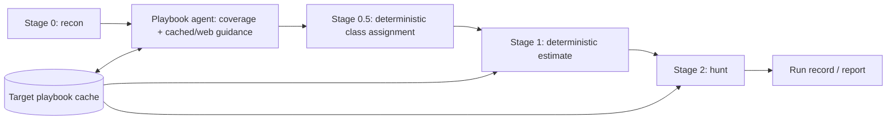

# Recon-guided playbook agent (Mode A)

An optional stage adds guidance for vulnerability families recon detects that
the fourteen built-in playbooks do not cover. The built-ins remain immutable.



## Use

Run `tools/scanner/install.sh` from the repository root to install the new
package along with the existing stages. Enable it for a product scan:

```bash
cd tools/scanner/cli
SCANNER_PLAYBOOK_AGENT=1 npm run secscan -- scan /path/to/target
```

The registry supplies the model, endpoint, credential name and token settings.
The product default is `luna6` (GPT-6 Luna); the lab default and previous model
entries retain their identities. This model is unmeasured on the benchmark.
Pricing uses the registry's verified token, cache-write and web-search rates,
service-tier, regional and long-context settings from Task 2a.

`SCANNER_PLAYBOOK_ALLOWED_DOMAINS` is an optional comma-separated list of search
domains. Its empty default sends no filter. Values are passed directly to the
Responses `web_search` tool's `filters.allowed_domains`. The agent chooses its
own queries; there is no query filter or enforced source allowlist.

The stage is opt-in per productization plan §3.4. It runs between recon and
class assignment in the CLI and in `run.sh ... all-v2` when enabled. For an
already prepared recon run it can also be called explicitly:

```bash
tools/scanner/run.sh --target /path/to/target --run-id RUN_ID luna6 stage-playbook-agent
```

Coverage and any web research run before the existing hunt confirmation, and
are billed by the selected provider. Each attempt appends to Task 2a's shared
spend ledger as well as this stage's usage artifact; the estimate and live hunt
gate include that spend. Requests pin recon's observed service tier, use the
shared pricing functions, and book conservative reservations when usage is
missing. Unsupported
Responses/web-search providers fail explicitly. No alternate model is selected
silently. No full scan or paid call was used to test this implementation.

## Decision and cache

`guidance.md` is loaded at runtime. A strict structured coverage call receives
the architecture, languages, frameworks, manifest section of recon's repo map,
file signals and counts, category applicability, built-in text and registry,
signal mappings, and available cached classes. It offers the Responses
`web_search` tool (`tool_choice: 'auto'`, with any configured domain filter):
the model searches when it judges the built-ins leave a surface recon shows
uncovered, and no search is required. The model returns a reason, the selected
built-ins and zero or more additional class definitions. Every class carries at
least one code; the text is free-form, stored as the model wrote it, and passes
through all stages to findings unchanged.

A code-driven loop of review turns follows that initial decision:

| Purpose | Runs | Asks the model to |
|---|---|---|
| `turn1` | once | reconcile each excluded built-in with recon's evidence; propose classes for surfaces no built-in covers |
| `turn2:pass<N>` | up to `SCANNER_PLAYBOOK_LOOP_PASSES` (default 1) | reconsider every class not selected; add one only when recon shows the target has its surface, naming that evidence in `changes`; the loop stops at the first pass that adds no class id |
| `turn3` | once | re-think the selection from `turn2_review`, the current classes and recon's data: keep a class without explanation, include or remove one only with recon evidence in `changes` |

Each turn is a decision call like the first, with web search available, and
returns the same schema plus `changes` (`{ id, why }` per addition, or per
inclusion and removal in turn3). Every
decision call's input starts with the same object (recon, signal counts,
signal mappings, built-ins, cached classes) so the calls share a cacheable
prefix; a turn appends the decision so far and the queries and sources
of every earlier decision call. turn3 alone also receives, last,
`turn2_review`: one `{ purpose, reason, changes }` entry per turn2 pass run, in
order, with `reason` and `changes` as that pass's model returned them, before
the union. `SCANNER_PLAYBOOK_LOOP=0` skips the turns and
runs the initial call only; any other value, or none, keeps them.
`SCANNER_PLAYBOOK_LOOP_PASSES` must be a positive integer; any other value fails
the stage before any model call. The purposes above, with `coverage` and
`research:<class-id>`, label each call in `usage.json` and the spend ledger.

`turn1` and `turn2` can only add classes; `turn3` keeps, includes or removes
them. Code enforces both. Each turn's output is validated like the initial
decision, except that turn3 may return a class selected before it with a blank
reason (it keeps its earlier one); a class turn3 newly includes needs one. A
`turn1` or `turn2` output is then merged as a union: built-ins by id, keeping
the first reason; additional classes by id, keeping the first definition
(framework, codes, signals, reason), so a later turn cannot redefine one. A
class such a turn omits stays selected and is listed in that turn's `restored`.
A `turn3` output is merged so that code applies an inclusion or removal only
with an explained `changes` entry (one whose `why` is not blank). A class turn3
returns that was already selected keeps its first definition and reason. A
class it omits is removed only when explained, and listed in its `removed`. A
class it returns that was not selected is included only when explained, and
listed in its `added`; an included built-in takes turn3's entry, and an
included additional class takes turn3's definition and is researched like any
other uncached class. An unexplained removal or inclusion is not applied and is
listed in the turn's `unexplained`. If the result would be empty, the set
before turn3 is kept unchanged and the turn records `prune_rejected: "empty"`.
The decision's `reason` is the latest merged turn's (turn3 keeps the earlier
one if its own is blank). A removed additional class is not researched and does
not reach the overlay.

Each uncached class in the final decision then gets a Responses call with
`web_search` (required) and a strict playbook schema. It returns a plain-text
playbook in the built-in format plus source URLs. The caller captures queries
from `output[].action.queries`.

Citing source URLs is optional. Every URL the output cites is kept as cited, in
order, in `source_urls`, which may be empty; no cited URL is a reason to fail.
Each is labelled against that call's own search sources:
`verified_source_urls` holds the well-formed http(s) URLs found among them,
`unverified_source_urls` every other cited URL, including malformed ones. The
research progress line reports `unverified=<n>`. The call must still perform a
web search, and the playbook must still pass the format, section and size
checks; a failure writes `research-failures/<class-id>.json` (which lists any
cited URL absent from the search as information) and stops the stage.
Repeated runs still assess current coverage, but reuse matching cached entries
instead of researching them again. Cached definitions keep their original
codes and signals together with their text; changing coverage cannot relabel
an old entry.

The decision calls also select the built-in classes that apply
(`builtin_classes`, each with a reason). The final decision's selected built-ins
plus its additional classes are the run's complete class set, recorded as
`selected_classes` in the plan and written to `class-selection.json`. When that
file exists, Stage 0.5 runs in agent mode: no floor classes; each hunt lane gets
the selected classes its file's signals reach; selected classes no hunt-eligible
file reaches are added to every hunt lane (`class_basis['selection-unrouted']`);
a lane left with no class is skipped. Without the file, Stage 0.5 output is
unchanged.

The cache lives at `reportsRoot(context)/playbooks/<class-id>/<framework>/<model>/`.
Product reports roots use `SCANNER_REPORTS_ROOT` (the CLI's `--out`), defaulting
to `<target>/.secscan`. They are shared across run IDs even when
`SCANNER_RUNS_ROOT` relocates per-run outputs. The benchmark reports root is its
configured runs root. The model path segment is percent-encoded. Each entry
contains `playbook.md` and `meta.json` with the cited source URLs and their
verified/unverified labels (absent from entries cached before labelling, which
still load), sha256 of the UTF-8 text, creation time, model, queries, class codes, and signal mappings. Cache
publication is atomic; existing entries are immutable. Missing or mismatching
hashes stop loading rather than silently supplying different guidance.

## Artifacts and hooks

`runPath(provider, 'stage-playbook-agent')` contains:

- `playbook-plan.json`: the final decision and its reason, whether any
  call searched, new classes and signal mappings, cache hits, all consulted
  playbooks with hashes and sources (an agent playbook's record carries the
  same verified/unverified labels as its cache entry). `turns` holds one entry per review turn
  (purpose, the ids the union `added` and `restored` — for turn3, the ids it
  included, and `restored` is `[]` — the ids turn3 `removed` — always present,
  `[]` for turn1 and turn2 — the model's `changes`, and the turn's search
  count, queries and sources; turn3 also records `unexplained`, the ids it
  removed or included without an explained `changes` entry, and
  `prune_rejected: "empty"` when its result was rejected); `loop` records
  `enabled`, `max_passes` and `passes_run`.
- `classes-overlay.json`: class-ID dictionary in the shipped registry's
  `playbook`/`codes` format, extended with `signals`, `framework`, `model`,
  and `sha256`. Built-in replacements and unknown signals are rejected.
- `class-selection.json`: the run's complete class set — selected built-in
  ids, additional class ids, and their sorted union. Stage 0.5 validates it
  against the shipped registry and the overlay before using it.
- `usage.json`: one entry per Responses request, including failures and
  incomplete responses, input/output, cached input, cache writes, reasoning
  tokens, search calls, query strings and sources. Usage is written before
  response validation. SDK automatic retries are disabled so requests are not
  hidden. Calls also append to `shared/ledger.ts`, which became available with
  Task 2a, so recon, playbook research and hunting share one spend total.
- `meta.json`: normal stage provenance; failed attempts cannot leave a
  previous overlay with successful provenance.

Stage 0.5 deterministically extends the signal tables when an overlay exists;
absent or empty overlays retain the shipped output. Its existing file selection
and skip rules still apply, including config/test files. Stage 1 adds cached
playbook lengths to the estimate. Stage 2 loads cached plain text for added
classes, includes their codes in findings, and records the guidance supplied
to lanes in `playbooks-used.json`. The CLI copies those records (or the agent
plan before hunting starts) to `run-record.json.playbooks`. Built-in records
have a repository source path and text hash; their web-source list is empty
because the original built-ins do not declare web sources.

## Tests

```bash
cd tools/scanner/stage-playbook-agent
npm ci
npm test
```

All model and web responses are mocked. The suite uses synthetic recon fixtures
and temporary caches/targets, including a one-file deterministic Stage 0.5 run
and import-only Stage 2 loading; it never launches recon or a hunting model.
